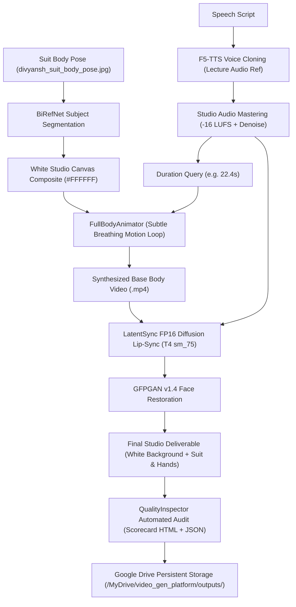

# Specification: Full-Body LatentSync Production Engine & Modular Colab Architecture

**Date:** 2026-10-11  
**Author:** Antigravity Engineering  
**Status:** Approved  
**Target Platform:** NVIDIA Tesla T4 (16GB VRAM) on Google Colab & Local Orchestrator  

---

## 1. Executive Summary

This specification establishes a dedicated full-body video generation subsystem for the `video_production_engine` repository. It utilizes the user's formal suit portrait (`assets/body_portraits/divyansh_suit_body_pose.jpg`), applies high-fidelity background removal (BiRefNet) to composite onto a pure white studio backdrop (`#FFFFFF`), synthesizes a natural subtle-motion base video, and executes diffusion lip-sync using LatentSync (FP16 patched for Turing T4). 

Furthermore, to ensure long-term maintainability, sustainability, and GPU quota efficiency, the notebook layer is decomposed into three specialized Colab notebooks.

---

## 2. Architecture & Components

### 2.1 Python Core Modules

1. **`src/video/fullbody_animator.py` (New)**:
   - **Responsibilities**:
     - Ingests high-resolution whole-body still portraits (e.g., `divyansh_suit_body_pose.jpg`).
     - Scales/pads image to diffusion-compatible mod-16 dimensions (e.g. 864×960 or 1080×1200).
     - Applies BiRefNet full-body subject segmentation to composite the subject cleanly onto a pure white studio canvas (`#FFFFFF`).
     - Synthesizes a matching-duration MP4 base video with configurable motion curves:
       - `subtle_breathing` (default): Sinusoidal micro-scale ($1.000$ to $1.008$) and vertical micro-displacement ($\pm 2$px) to emulate living presence without limb distortion.
       - `static_hold`: Zero-distortion static frame repetition.
   - **Dependencies**: `opencv-python` / `PIL`, `numpy`, `src.enhancers.background.BackgroundMattingEnhancer`.

2. **`src/video/latentsync_engine.py` (Updated)**:
   - Enhances `LatentSyncEngine` to accept either a pre-rendered video or an image portrait source with an automatic base video generator.
   - Ensures T4 Turing sm_75 FP16 patch is applied and checked prior to execution.

3. **`src/pipeline.py` (Updated)**:
   - Extends `VideoProductionPipeline.produce_video()`:
     - Adds `body_image_path: Optional[str] = None`.
     - Adds `motion_mode: str = "subtle_breathing"`.
     - Adds `studio_backdrop: str = "#FFFFFF"`.
     - When `engine="latentsync"` and no `base_video_path` is passed, automatically constructs the base video using `FullBodyAnimator`.

4. **`src/avatar/profile.py` & `src/avatar/manager.py` (Updated)**:
   - Adds `optimal_body_pose_path` and `optimal_body_pose_score` fields to `AvatarProfile`.
   - Adds `register_media(..., media_type='body_pose')` to compute full-body pose clarity and store pointers to body portraits.

---

### 2.2 Modular Colab Notebook Hierarchy

Rather than a single bloated notebook that risks out-of-memory errors and high setup overhead, the notebooks are separated into three dedicated workflows under `notebooks/`:

1. **`notebooks/01_avatar_knowledge_base.ipynb`**:
   - Lightweight, zero-diffusion runtime.
   - Connects to Google Drive, ingests lecture audio, portraits, and whole-body suit poses.
   - Runs automated scoring (SNR, Laplacian sharpness, pose detection).
   - Updates `avatar_profile.json` on Google Drive.

2. **`notebooks/02_talking_head_studio.ipynb`**:
   - Optimized for fast 2D portrait head animations using SadTalker / LivePortrait.
   - Ideal for quick script testing and short social reels (~3-5 min turnaround).

3. **`notebooks/03_fullbody_latentsync_studio.ipynb`**:
   - Dedicated heavy-duty studio environment for full-body video production.
   - Loads whole-body suit pose, synthesizes base video on white studio backdrop (`#FFFFFF`), executes FP16 LatentSync, runs GFPGAN face restoration, and conducts autonomous QualityInspector verification.

---

## 3. Data Flow & Execution Sequence

---

## 4. Error Handling & Edge Cases

1. **Tesla T4 Memory Constraints**:
   - LatentSync requires ~7.8GB VRAM in FP16. F5-TTS requires ~2.5GB.
   - Sequential VRAM fences (`torch.cuda.empty_cache()` + `gc.collect()`) are enforced between audio synthesis and diffusion video inference.
2. **Dimension Constraints**:
   - Input suit image (855×954) is padded/scaled to mod-16 dimensions (864×960) with centered letterboxing on `#FFFFFF` to ensure compatibility with UNet latent representations.
3. **Colab Quota Exhaustion**:
   - `ColabQuotaMonitor` listens for backend exhaustion signals and triggers multi-account migration notices per `COLAB_RESOURCE_OPTIMIZATION_GUIDE.md`.

---

## 5. Verification Plan

- **Unit Testing**:
  - `tests/test_fullbody_animator.py`: Validate mod-16 dimension padding, frame generation count, duration matching, and subtle breathing sinusoid curve calculation.
  - `tests/test_avatar_system.py`: Validate `AvatarProfile` serialization with `optimal_body_pose_path`.
- **Integration Testing**:
  - Run all pytest test suites locally without GPU to ensure syntax and structure pass with zero errors.
- **Notebook Verification**:
  - Generate and validate JSON schemas for `01_avatar_knowledge_base.ipynb`, `02_talking_head_studio.ipynb`, and `03_fullbody_latentsync_studio.ipynb`.
